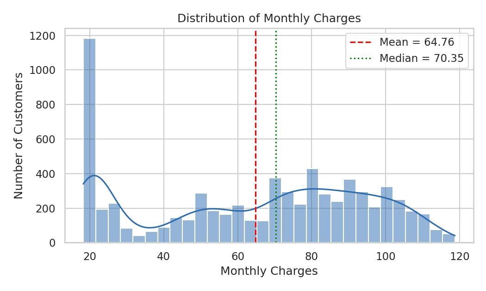
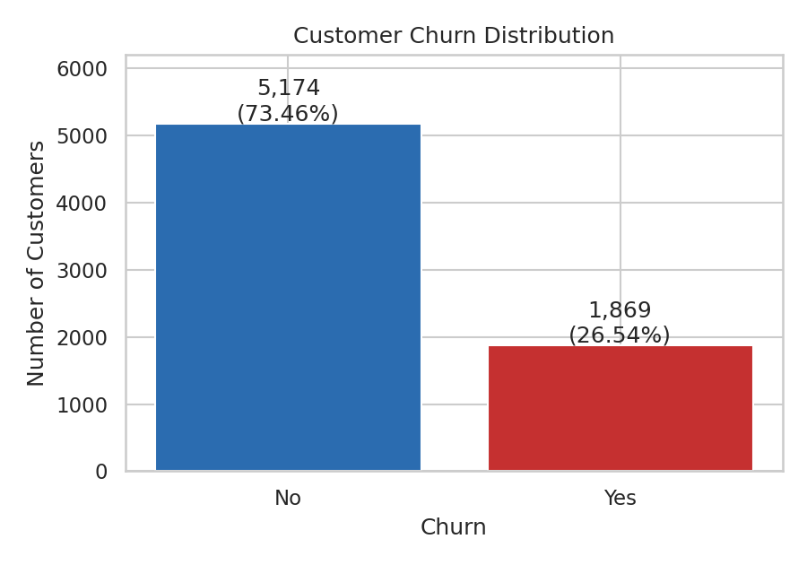
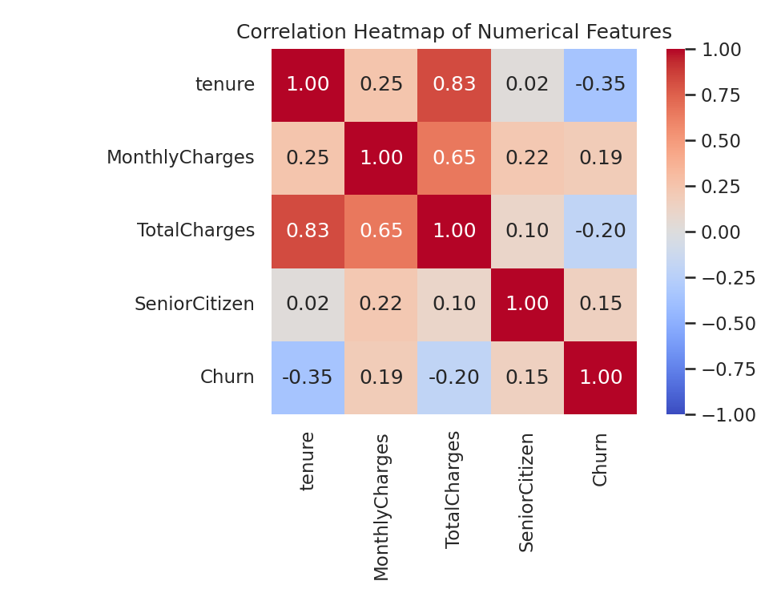
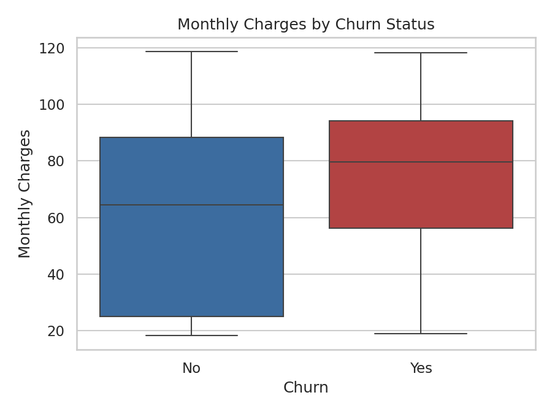
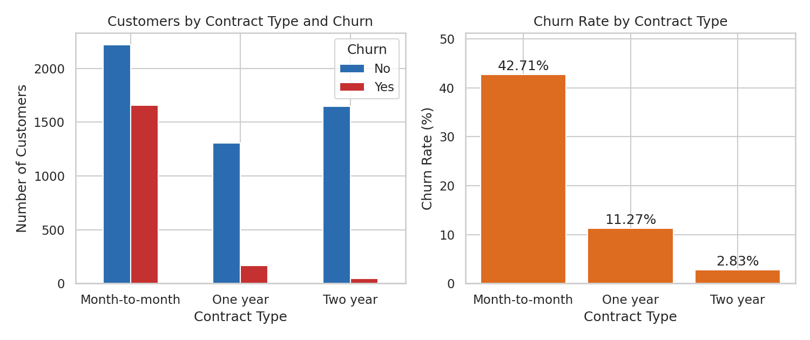

# EDA Summary

_Generated by `python -m src.eda` from the downloaded IBM Telco Customer Churn CSV. All figures below are computed from that file._

## Dataset

- Rows: **7,043**, columns: **21**
- Duplicate rows: **0**; duplicate customer IDs: **0**
- Missing (NaN) values in the raw file: **0**
- Blank strings in raw file: **{'TotalCharges': 11}**
- Other data problems detected: ['TotalCharges: 11 non-numeric/blank entries']

`TotalCharges` is stored as text in the raw CSV and has 11 blank entries. All of them belong to customers with `tenure == 0` (no billing yet), so `clean_data` sets them to 0. No rows are removed.

## Target variable

| Churn   |   customers |   percentage |
|:--------|------------:|-------------:|
| No      |        5174 |        73.46 |
| Yes     |        1869 |        26.54 |

26.54% of customers churned, so the classes are imbalanced. A model that always predicts "No" would be about 73.46% accurate, which is why precision, recall, F1 and ROC-AUC are reported alongside accuracy.

## Numerical summary

|       |   tenure |   MonthlyCharges |   TotalCharges |
|:------|---------:|-----------------:|---------------:|
| count |  7043    |          7043    |        7043    |
| mean  |    32.37 |            64.76 |        2279.73 |
| std   |    24.56 |            30.09 |        2266.79 |
| min   |     0    |            18.25 |           0    |
| 25%   |     9    |            35.5  |         398.55 |
| 50%   |    29    |            70.35 |        1394.55 |
| 75%   |    55    |            89.85 |        3786.6  |
| max   |    72    |           118.75 |        8684.8  |

### Potential outliers (IQR rule)

| feature        |     q1 |      q3 |     iqr |    lower |   upper |   flagged |
|:---------------|-------:|--------:|--------:|---------:|--------:|----------:|
| tenure         |   9    |   55    |   46    |   -60    |  124    |         0 |
| MonthlyCharges |  35.5  |   89.85 |   54.35 |   -46.02 |  171.38 |         0 |
| TotalCharges   | 398.55 | 3786.6  | 3388.05 | -4683.52 | 8868.67 |         0 |

A flagged value is a candidate for inspection, not an automatic error. No observations are removed on the basis of this rule.

## Chart interpretations

### Figure 1 - Monthly charges
Mean 64.76, median 70.35, standard deviation 30.09, range 18.25 to 118.75. Compare the mean and median with the histogram to see whether the distribution is skewed or multi-modal.

### Figure 2 - Churn distribution
1,869 churned and 5,174 stayed.

### Figure 3 - Correlation heatmap
Pearson correlation of each numerical feature with churn (1 = churned): tenure -0.35, MonthlyCharges +0.19, TotalCharges -0.20, SeniorCitizen +0.15. Correlation measures linear association only and does not show causation; tenure and TotalCharges also overlap strongly with each other.

### Figure 4 - Monthly charges by churn status
Median monthly charge: 64.43 for customers who stayed versus 79.65 for customers who churned. Median tenure: 38 versus 10 months.

### Figure 5 - Churn rate by contract type
| Contract       |   customers |   churned |   churn_rate_pct |
|:---------------|------------:|----------:|-----------------:|
| Month-to-month |        3875 |      1655 |            42.71 |
| One year       |        1473 |       166 |            11.27 |
| Two year       |        1695 |        48 |             2.83 |

The highest churn rate is for **Month-to-month** (42.71%) and the lowest for **Two year** (2.83%).

## Other observations

- Highest churn by payment method: **Electronic check** (45.29%); lowest: **Credit card (automatic)** (15.24%).
- Highest churn by internet service type: **Fiber optic** (41.89%); lowest: **No** (7.4%).

## Limitations

- The dataset is an IBM sample dataset; its representativeness of real customer populations is unknown.
- It is a single snapshot with no time dimension, so changes in behaviour over time cannot be studied.
- The patterns above are associations. They do not show that changing a customer's contract, payment method or price would change whether the customer leaves.
- EDA statistics are computed on the full dataset for description only; all model fitting uses training data only.
